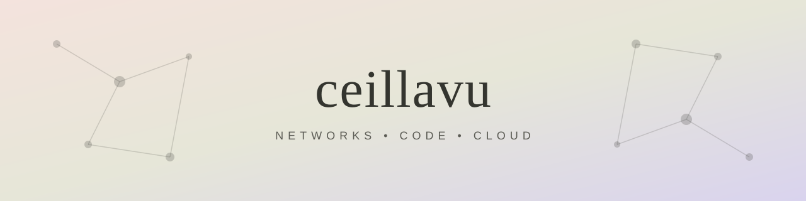

*networks, code, and a lot of coffee*

[LinkedIn](https://linkedin.com/in/marcella-markus)

## ୨୧ hi, i'm marcella

network computing student at UNIMAS, sarawak. i like networking and security,
and i'm slowly getting into python automation. 🐈

## ୨୧ projects

**[ai-mfa-security-system](https://github.com/ceillavu/ai-mfa-security-system)**
a flask login app that scores how risky each login looks using a random forest
model. low risk gets an email OTP, medium gets a delay, high gets a lockout.
solo project, python + flask.

**[energy-hero-SDG-7](https://github.com/ceillavu/energy-hero-SDG-7)**
a java swing quiz app about clean energy, with a
[browser version](https://ceillavu.github.io/energy-hero-SDG-7/).
group project. i built the main GUI, UI handler and exception handling.

## ୨୧ tools

python · java · html/css/js · git · gns3 · cisco packet tracer
